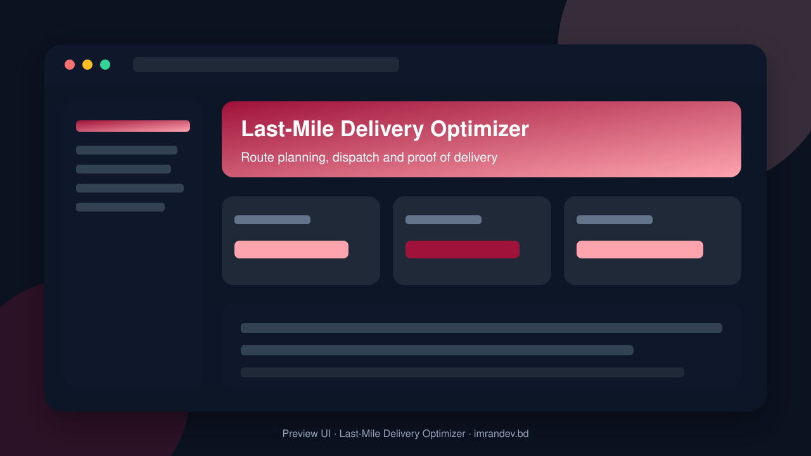
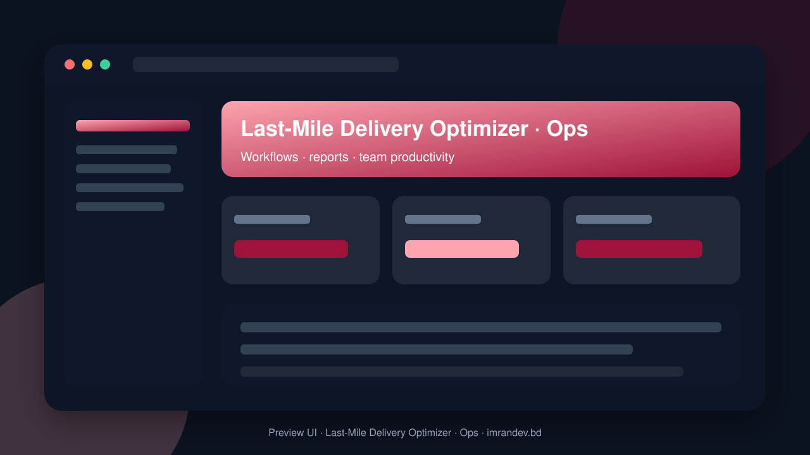

<p align="center">
  
</p>

<h1 align="center">Last-Mile Delivery Optimizer</h1>

<p align="center"><strong>Route planning, dispatch and proof of delivery</strong></p>

<p align="center">
  <a href="https://github.com/imranbru99/last-mile-delivery-optimizer-routing"></a>
  
  
</p>

---

## Overview

**Last-Mile Delivery Optimizer** is a complete business application focused on real operational workflows. This README lists the full feature surface so GitHub visitors and search engines can understand every capability of the product.

## Product preview

| Dashboard | Operations |
| :---: | :---: |
|  |  |

## Complete feature list

### Application modules

- Address Book
- Ai Address
- Ai Copilot
- Ai Support Bot
- Anomaly Fraud
- Api Tokens
- Assets
- Attempts
- Attendance
- Audit Log
- Auto Assignment
- Automation
- Batching Waves
- Chat
- Cod
- Cod Settlement
- Cold Chain
- Compliance
- Concerns
- Contracts
- Core
- Crm
- Cross Dock
- Customer Tracking
- Dashboards
- Data Export
- Delivery Preferences
- Demand Forecast
- Dispatch Board
- Driver Pwa
- Drivers
- Dynamic Reopt
- Eta Prediction
- Ev Management
- Exception Center
- Expenses
- Feedback
- File Manager
- Fleet
- Fleet Mix
- Franchise
- Fuel
- Gdpr
- Gig Marketplace
- Help Center
- Hr Lite
- Hubs
- I18n
- Integrations
- Inventory
- Invoicing
- Lead Gen
- Live Tracking
- Lockers
- Loyalty
- Maintenance
- Merchant Portal
- Multi Currency
- Multi Leg
- Nl Reports
- Notifications Center
- Notifications Hub
- Orders
- Payments
- Payroll
- Pickups
- Pod
- Pricing
- Profitability
- Public Api
- Recurring Routes
- Reports
- Returns
- Route Optimization
- Saas Billing
- Scenario Simulator
- Smart Eta
- Subcontractors
- Sustainability
- System Health
- Telematics
- Territories
- Ticketing
- Users Roles
- White Label

### Admin / Filament resources

- Audit Shipment
- Business
- Cod Settlement
- Driver
- Expense
- Fuel Log
- Hub
- Inbound Shipment
- Invoice
- Lead
- Merchant Shipment
- Module Catalog
- Payment
- Rate Card
- Route
- Shipment
- Ticket
- User
- Vehicle
- Zone

### Domain models

- Address
- Business
- Business Module
- Cod Settlement
- Delivery Route
- Driver Location
- Driver Profile
- Expense
- Fuel Log
- Hub
- Invoice
- Lead
- Maintenance Log
- Merchant Profile
- Module
- Payment
- Proof Of Delivery
- Rate Card
- Route Stop
- Shipment
- Shipment Event
- Ticket
- Ticket Message
- Vehicle
- Zone

### HTTP / API controllers

- Content APIs & screens
- Demo APIs & screens
- Driver Location APIs & screens
- Driver Pod APIs & screens
- Features APIs & screens
- Home APIs & screens
- Invoice Pdf Download APIs & screens
- Modules APIs & screens
- Pricing APIs & screens
- Routes APIs & screens
- Shipments APIs & screens
- Solutions APIs & screens
- Track APIs & screens
- Tracking APIs & screens

### Detailed feature requirements delivered

- PHP 8.3+, Laravel (latest stable), **Filament (latest stable)** for all admin and role panels
- MySQL/MariaDB, Redis (cache/queue/sessions), Laravel Horizon or database queues as fallback
- Frontend for public pages: Blade + Tailwind CSS + Alpine.js (jQuery only where unavoidable)
- Maps: Leaflet + OpenStreetMap by default, with a pluggable driver for Google Maps / Mapbox
- Routing engine: pluggable driver (OSRM / GraphHopper / Google Routes / built-in heuristic solver)
- Real-time: Laravel Reverb (or Pusher-compatible) for live tracking
- Tests: Pest/PHPUnit feature tests for every module
- The core requirement: **every business can turn any module ON or OFF** depending on what they need. The app must run correctly with any combination of modules enabled.
- Create a `modules` registry (table + config + service) with: key, name, description, icon, category, dependencies, version, default state, pricing tier, settings schema.
- Create a `tenant_modules` (or `business_modules`) table storing enabled/disabled state and per-module settings per business.
- Multi-tenancy: **single database with `business_id` scoping** (global scopes + policies), supporting many businesses on one install. Include a Super Admin who manages all businesses.
- A `ModuleManager` service with `isEnabled($module)`, `enable()`, `disable()`, dependency checking (cannot disable a module required by another enabled module; cannot enable one with unmet dependencies) and caching.
- A **Module Marketplace page** in each business admin: cards with toggle, description, dependencies, settings button, and "what you lose if disabled" notes.
- **Super Admin** (platform owner): businesses, plans, module catalog, billing, system health, global settings, impersonation, audit logs
- **Business Owner / Admin**: full control of their business, module marketplace, settings, billing
- **Operations Manager / Dispatcher**: route planning, dispatch board, live map, exceptions
- **Hub / Warehouse Manager**: inbound, sorting, load-out, inventory, hub staff
- **Driver / Rider** (mobile-first panel + PWA): assigned routes, turn-by-turn stop list, navigation links, POD capture, cash collection, attendance, earnings
- **Fleet Manager**: vehicles, maintenance, fuel, inspections, documents
- **Finance / Accountant**: invoices, COD reconciliation, driver payouts, expenses, taxes
- **Customer Support Agent**: tickets, shipment lookup, re-delivery requests, refunds
- **Merchant / Shipper (B2B client)**: own portal for creating orders, bulk upload, tracking, invoices, API keys, webhooks
- **End Customer / Recipient**: tracking page, delivery rescheduling, preference selection, feedback, tipping
- **Franchise / Agent Partner** (module): sub-business with commission tracking
- **Auditor / Read-only viewer**
- Granular permissions per module/resource/action, custom role builder per business, 2FA, login history, device/session management, IP allowlists (optional).
- Business & Organization profile, branding (logo, colors, domain), localization, currency, timezone, units (km/mi)
- Users, roles, permissions, teams, invitations
- Notifications center, activity/audit log, settings, file manager, API tokens
- **Orders/Shipments**: single and bulk create, CSV/Excel import and export, API intake, parcel dimensions/weight, service level, time windows, priority, special handling, barcode/QR labels
- **Address Book & Geocoding**: autocomplete, address validation and normalization (multi-language, using laravel-ai-catalog / AI Hub for cleaning), geofence zones, what3words-style optional, duplicate detection
- **Pickup Management**: scheduled/recurring pickups, pickup routes
- **Returns / Reverse Logistics (RMA)**: return pickups, QC, restock
- **Multi-leg / Hub-and-Spoke Shipments**: first-mile, middle-mile, last-mile legs
- **Cash on Delivery (COD)**: collection, reconciliation, remittance to merchants
- **Proof of Delivery (POD)**: photo, signature, OTP, geotag, barcode scan, recipient name, ID check
- **Delivery Attempts & Exceptions**: failed reasons, auto re-attempt rules, reschedule, return-to-sender
- **Dynamic / Real-time Re-optimization**: insert new orders, handle cancellations, traffic delays, driver breakdowns; re-sequence in-flight routes
- **Multi-day & Recurring Route Planning**: templates, standing routes, territory routes
- **Territory & Zone Management**: draw polygons on the map, assign drivers/hubs, auto-assign by zone, zone-based pricing
- **Dispatch Board**: drag-and-drop assignment, Kanban + map + timeline (Gantt) views, bulk assign, auto-dispatch rules
- **Scenario Simulator / What-If**: compare route plans side by side (cost, time, km, emissions), save and apply
- **Auto-Assignment Rules**: nearest driver, load balance, skill match, rating-based, SLA-priority
- **Batching & Wave Planning**: cut-off times, waves, consolidation, cross-docking
- **Fleet Mix Optimizer**: recommend the best vehicle type/size and fleet size
- **Live Tracking Map**: real-time driver positions, route progress, geofence alerts, playback/history replay
- **Driver Mobile App (PWA)**: offline-first stop list, background GPS pings, navigation deep links (Google/Waze/Apple/OSM), barcode scan, POD capture, chat, SOS button
- **Customer Tracking Portal**: public tracking by code/phone, live ETA map, branded, multi-language
- **ETA Prediction & Delay Alerts**: historical + traffic + AI-assisted
- **Notifications Hub**: SMS, WhatsApp, Email, Push, Voice/IVR, in-app; template builder per event/language; provider drivers (Twilio, local BD SMS gateways, etc.)
- **Customer Delivery Preferences**: time slots, safe-place, neighbor, locker, reschedule, redirect
- **Two-way Chat**: driver ↔ customer (masked numbers), dispatcher ↔ driver
- **Exception Management Center**: SLA breach, failed delivery, damaged, lost; workflow and escalation
- **Vehicle Management**: types, capacity, documents/expiry alerts, assignment history
- **Maintenance & Inspections**: schedules, work orders, DVIR checklists, parts
- **Fuel & Expense Tracking**: fuel cards, mileage, anomaly detection
- **Telematics/GPS Device Integration**: generic webhook/MQTT/HTTP ingestion drivers
- **Electric Vehicle Management**: charge planning, range-aware routing
- **Equipment & Asset Tracking**: bags, crates, scanners, cold-chain boxes
- **Cold Chain / Temperature Monitoring**: sensor readings, alerts, compliance reports
- **Hub & Warehouse Management**: hubs, bins, inbound scanning, sorting, load-out, manifests, dock scheduling
- **Inventory (light WMS)**: stock per merchant, pick/pack, cycle count
- **Lockers / Pickup Points (PUDO)**: locker/agent points, capacity, OTP pickup
- **Cross-dock & Transfer Manifests**
- **Driver Management**: onboarding, documents/licence expiry, ratings, performance scorecards, gamification/leaderboards, training records
- **Attendance & Shifts**: via `laravel-attendance-hub` (biometric/RFID/face machines, app check-in, geofenced check-in), rosters, shift bidding, leave, overtime
- **Payroll & Driver Payouts**: per-delivery/per-km/per-hour/commission/tier incentives, penalties, advances, payslips (laravel-unicode-pdf), payment export
- **HR-lite**: staff directory, contracts, documents, announcements
- **Gig/Freelance Driver Marketplace**: open jobs, bidding, instant pay-out requests
- **Subcontractor/Third-party Carrier Management**: rate cards, auto-routing to partner carriers, partner API

### Platform capabilities

- Multi-role ready structure for operators, managers and admins
- Database migrations and seeders for demo-ready local setup
- Laravel architecture with services/controllers/models separation
- Responsive UI foundation (Blade / Filament where enabled)
- Environment-based config for local and production databases
- GitHub-ready documentation with visual product previews

## Tech stack

- PHP 8.2+ / Laravel
- Filament admin resources (where enabled)
- Vite asset pipeline
- SQLite/MySQL-ready database layer
- Migrations, seeders, and test-ready structure

## Quick start

```bash
git clone https://github.com/imranbru99/last-mile-delivery-optimizer-routing.git
cd last-mile-delivery-optimizer-routing
composer install
cp .env.example .env
php artisan key:generate
php artisan migrate --seed
npm install && npm run build
php artisan serve
```

## Repository

- GitHub: https://github.com/imranbru99/last-mile-delivery-optimizer-routing
- Developer: **Imran Ahmed** · https://imrandev.bd

---

## 🤝 Let's Connect & Collaborate

I am open to **Senior Remote Full-Stack Roles**, AI Platform Architecture Contracts, and Enterprise Technical Advisory.

**Timezone:** UTC+6 (Dhaka / Rangpur, Bangladesh) — flexible overlap with US, UK & EU hours.  
**Delivery:** Async-ready · Slack · Discord · Jira · GitHub · production-first accountability.

| Channel | Handle | Link |
| :--- | :--- | :--- |
| Portfolio | imrandev.bd | https://imrandev.bd |
| Packagist | imrandevbd | https://packagist.org/packages/imrandevbd/ |
| LinkedIn | imranbru99 | https://linkedin.com/in/imranbru99 |
| GitHub | imranbru99 | https://github.com/imranbru99 |
| WhatsApp | +880 1576-918420 | https://wa.me/8801576918420 |
| Email | me@imrandev.bd | mailto:me@imrandev.bd |
| X | @imrandev_bd | https://x.com/imrandev_bd |
| YouTube | @ImranDevBD | https://youtube.com/@ImranDevBD |
